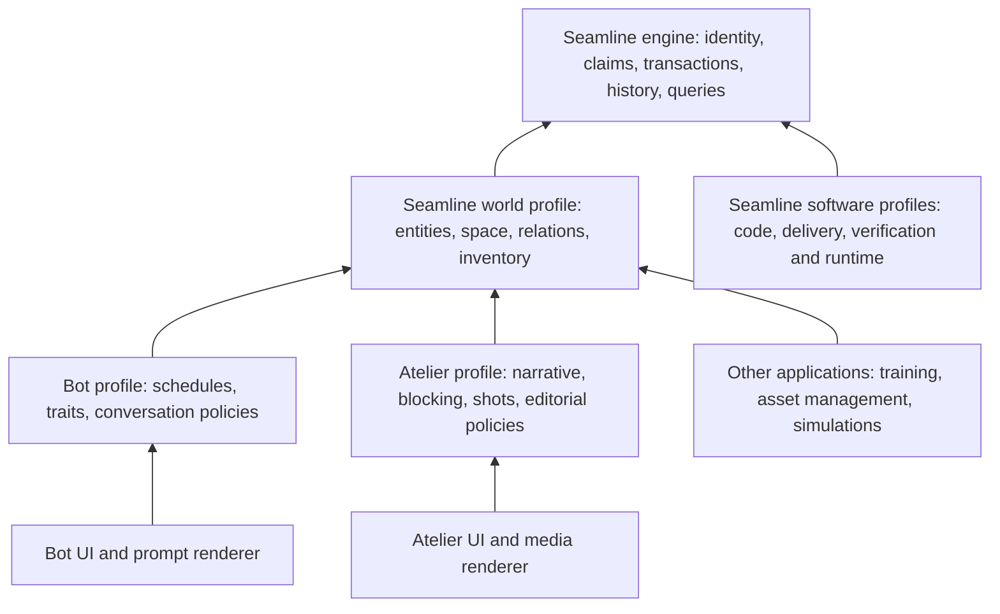

# Seamline as the shared world engine

Status: proposed architecture and implementation specification, 2026-09-09. This document does not claim the proposed API or packages already exist. Source findings and executed checks are in [the review](review.md).

The expanded target is specified in [Seamline's semantic and temporal engine](semantic-engine.md), including universes, worlds, timelines and arbitrary domain definitions. [Comprehensive codebase intelligence](codebase-intelligence.md) defines the software domain beyond the existing code-analysis baseline. This document specifies the shared-world application slice and the initial engine evolution within that broader architecture.

**Seamline owns objects, positions, locations, relationships, ownership, inventory, and their history. The bot and Atelier define specifics on top of that engine.** They must not maintain competing authoritative copies of those facts.

The same jacket, room, person and ownership relation must have the same identity when used in a companion conversation, a cinematic story, a wardrobe view, or a later inventory application. Editing a shot does not move the jacket. Lending the jacket changes custody but not ownership. Hiding the jacket from a frame does not delete it from the world.

## 1. Architecture and ownership



All persistent semantic records—including application-specific ones—are modeled through registered Seamline profiles and stored through its engine. Applications may own transient UI selection, local caches and provider connections. Media bytes can live in object storage; their artifact identity, provenance, bindings and revision metadata belong in Seamline.

| Layer | Owns | Must not do |
|---|---|---|
| Seamline engine | Profile registration, scoped identity, typed claims, revisions, atomic commands, evidence, history, bounded queries, validation and projection infrastructure | Impose romance, narrative arcs, Telegram, video aspect ratio or a simulation schedule |
| Seamline world profile | Objects/agents/places, spatial relationships, custody/ownership, inventory, equipment, directed relationships, scene state, semantic detail requests | Encode one cast, wardrobe, city, or chat behavior |
| Bot profile | Character stats, schedule/absence rules, relationship interpretations, active interaction locks, turn policy, context budget | Write separate canonical `scene.place`, `sim.items` or ownership dictionaries |
| Atelier profile | Story/beat structure, role-bound situations, blocking, shot recipes, coverage, takes, timeline placements, editorial rules | Infer or overwrite world truth simply by generating prose or a picture |
| Software intelligence profiles | Code, data, contracts, behavior, requirements, verification, build/deployment/runtime lineage and impact; preserve existing extraction/contradiction behavior | Apply extraction tombstoning or source precedence indiscriminately to a live world |

Start with logical modules, not a dozen independently released packages. The important dependencies are `application profile → world profile → engine` and `code profile → engine`. Neither application profile depends on the other's private vocabulary.

## 2. Profiles make the ontology composable

A profile is a versioned semantic module, not just a list of field names. It registers:

- Namespaced kinds and property schemas, including units and reference types.
- Relationship signatures: valid endpoints, direction, inverses, cardinality and temporal rules.
- Commands, preconditions, deterministic reducers and invariants.
- Derived queries and projection capabilities.
- Evidence/adoption policies and completeness requirements for each rule.
- Schema migrations and conformance fixtures.

Suggested initial profile IDs: `seamline.code@1`, `seamline.world@1`, `bot.companion@1`, `atelier.studio@1`. These are initial compositions of the more granular domain packs described in the expanded target, not an exhaustive or fixed kind list. Their definitions are loaded by Seamline. Application-specific content packs instantiate their types and recipes.

Composition resolves a pinned dependency graph of profiles. Reject conflicting definitions of the same fully qualified kind/property, incompatible major versions, unresolved references, and migrations that would silently reinterpret units. Extension profiles may add namespaced properties and stronger application constraints; they cannot weaken world invariants. No arbitrary `Record<string, unknown>` escape hatch for a claimed validated kind. Unknown extensions may be preserved opaquely during import, but cannot participate in reasoning until their profile is available.

For recipes, bind typed role slots explicitly. A `lend-item` situation takes `lender: Agent`, `borrower: Agent`, `item: ObjectInstance`, `place: Place`. An OTS recipe takes subject and foreground-observer bindings. Replacing a character is substitution of a compatible binding, not string replacement in a prompt. Each recipe declares required inputs, offered outputs and effects; the engine rejects unresolved or incompatible bindings before execution.

## 3. Identity, scopes and state

Separate **definition**, **instance**, and **representation**:

| Record | Example | Identity rule |
|---|---|---|
| Definition | Charcoal jacket design; generic room layout | Stable namespaced ID plus immutable revision |
| Instance | Calder's particular jacket; one building's lobby | Persisted ID minted once or imported from a stable source key |
| Representation | An image of that jacket; its inventory icon | Separate artifact ID referring to the represented instance/revision |
| Recipe | OTS framing; object handoff situation | Versioned definition with role slots |
| Occurrence | Today's handoff; shot 17 in a particular edit | Stable occurrence ID independent of recipe, display name, and list position |

Preserve existing code-profile natural IDs. Do not impose those reconstruction rules on runtime instances. Re-import uses an explicit mapping `(source namespace, source key) → entity ID`; it never remints every instance. Two identical jackets remain distinct. Renaming a person changes a label, not all references. Imported name matches remain candidates until their identity is established.

Every operation has an authorized scope: tenant/project, world, branch and optional private interaction context. World identity is shared only within an explicitly selected world. A reusable character definition can create different instances in different worlds. Private beliefs and user relationships do not become public world facts merely because they refer to a shared person.

Snapshots pin a branch revision and valid time. Facts use half-open valid-time intervals `[from, to)`; recorded time/revision records when the engine learned or accepted the claim. This supports a correction learned today about yesterday without rewriting what an earlier consumer knew. A branch pins its parent revision at creation; later parent edits do not leak into it.

History has two modes inside the same engine:

- **Source extraction:** authoritative-scope replacement and tombstoning, preserving current code-profile semantics.
- **World transactions:** append commands/events and claim changes; derive current state. No disappearance by omission from a camera view or prompt projection.

Do not model runtime turns as fake extraction runs simply to fit the existing API.

## 4. World vocabulary

Use a small set of base kinds with profiles/facets, rather than a new unrelated kind for every object.

| Kind | Responsibilities |
|---|---|
| `Agent` | People, characters, organizations or other acting entities; capabilities and role bindings |
| `Place` | Region, building, room, named area or addressable slot; topology and spatial reference |
| `ObjectDefinition` / `ObjectInstance` | Reusable object properties versus particular objects with state/history |
| `StockLot` | Quantity of fungible stock, unit, lot properties, custody and location |
| `Frame` | Named coordinate reference with dimension, units, handedness and optional parent transform |
| `Scene` | Scoped interval/activity, participant bindings, focus and referenced world snapshots |
| `Event` | Accepted state transition with actor, causal command, before/after references and time |
| `Claim` / `Observation` | Attributed assertion, evidence, validity and acceptance state |
| `Artifact` | Stored representation with media type, origin, inputs and verification state |

Important typed relations include:

| Relation | Semantics |
|---|---|
| `instanceOf(instance, definition)` | Type/template lineage, not physical containment |
| `partOf(child, assembly)` | Structural membership; distinct from putting an object in a bag |
| `within(place, place)` | Physical place hierarchy; acyclic |
| `connects(place, place)` | Traversable connection with directional access/travel constraints |
| `placedAt(entity, place-or-container)` | Immediate physical placement; current authoritative placement is exclusive unless a profile explicitly models an extended/distributed entity |
| `owns(agent, item)` | Ownership entitlement; initially exclusive ownership, with an explicit later extension for shares |
| `hasCustody(agent, item)` | Temporary control/possession, independent of ownership |
| `equippedBy(item, agent, slot)` | Worn/equipped binding with slot and layering rules; requires compatible placement/custody |
| `supports(surface, entity)` | On-table/on-chair relationship, compatible with enclosing place |
| `faces`, `looksAt`, `holds` | Typed participant/object bindings, optional body/equipment slots |
| `participatesIn(agent, scene)` | Scene role; not automatically visible in every shot |
| `relatedTo(agent, agent, relationType)` | Directed, scoped relationship occurrence; profile defines meaning and attributes |

Relation occurrences need IDs or claim IDs because multiple instances of the same relation can exist across time, sources, scenes or branches. A single unique `(src, dst, kind)` edge cannot represent that history. N-ary relationships—such as an agent holding an item with their left hand—are typed relation records with role bindings, not ambiguous bags of string edges.

### Spatial state and position

Support named topology first, with optional geometry. `lobby → hotel → city`, `jacket → bag → person → lobby` can answer location without coordinates. Derived containing-location queries follow placement/container chains with cycle detection and bounded depth. Leaving a room changes placement; its furniture remains in that room.

A spatial pose may add position/orientation in a declared `Frame`. Values require units, reference frame, validity and precision. Do not compare coordinates in unrelated frames without a known transform. Distinguish world pose, relative blocking (“left of table”), and image coordinates (“subject at x=.33”); they cannot share a `position` field. Missing geometry yields an unknown geometric answer, while topology can still answer co-location.

Scene blocking refers to stable subjects and spatial anchors. A camera creates a view of that arrangement. Basic screen direction/eyeline constraints can live in the Atelier profile; world coordinates and topology stay in the world profile. Geometry storage does not imply that Seamline is a physics or rendering engine.

### Inventory, ownership and equipment

Inventory is a query, not a second mutable list: ask separately for owned, carried, stored-at-place, equipped, reserved or available items. A borrowed jacket belongs in “carried” without appearing in “owned.” A jacket put into a bag moves with the bag through derived location; it does not need manual updates in every inventory view.

Commands distinguish `transferOwnership`, `lend`, `return`, `move`, `equip`, `unequip`, `consume`, `splitLot` and `mergeLots`. Ownership transfer does not imply physical teleportation. Equipment may involve multiple layers in a body slot; the profile defines compatibility rather than globally restricting every slot to one garment. Quantity uses explicit units and exact integer/decimal representation, cannot become negative, and is conserved except under declared creation/consumption/conversion operations. Fungible items still need transaction evidence; the bot's old “no item history for fungibles” is a display/storage policy, not a universal ledger rule.

### Social relationships and knowledge

Relationships have direction, context and time. `A trusts B` is not `B trusts A`. Professional role, affection, obligation and contract ownership are different predicates. The bot defines numerical scales and interpretation; Atelier can define dramatic relationships without importing the bot's stat model.

Knowledge/belief is scoped to an agent or narrative viewpoint. A character's belief that a key is in a drawer does not overwrite the key's actual placement. A shot revealing that belief is an Atelier representation of the belief, not a competing global location claim. Store these distinctions in Seamline so both consumers can use them correctly.

## 5. Evidence and canonical adoption

Each claim carries origin, source reference, confidence, scope, valid interval, and a separate adoption status such as `proposed`, `accepted`, `rejected` or `superseded`. Preserve original attribution when a proposal is adopted. The origin labels and adoption rules are profile-specific: code extraction retains its existing fact policy; a story author can authorize canon inside their branch.

The engine distinguishes:

1. The user said a jacket moved.
2. A parser proposed `move(jacket, kitchen)`.
3. A permitted command adopted that change after validation.
4. A render request asked for the jacket in the kitchen.
5. An image was generated.
6. An observation or review verified that the image depicts it there.

None automatically proves the next. Vision-based tracking can later emit observations with frame/time/bounds and identity hypotheses into the same engine. It is not implemented by having a scene graph. Low-confidence identity resolution cannot transfer ownership.

Constraints return `satisfied`, `violated`, `unknown`, or `notApplicable`, with evidence and required coverage. Missing data never becomes a random default. A capability query can say “known room, unknown geometry” without saying the world is invalid. Hard commit invariants such as quantity conservation differ from advisory artistic assessments such as weak tension.

## 6. Commands, concurrency and deterministic history

Illustrative API, to be implemented in Seamline:

```ts
engine.registerProfile(profile);
engine.submit({ scope, expectedRevision, commandId, actor, validAt, command });
engine.snapshot({ scope, revision, validAt });
engine.query({ scope, revision, validAt, query, limit });
engine.explain({ scope, revision, claimId });
engine.project({ snapshotRef, profile, bindings, detailRequest });
```

`submit` checks caller capabilities, profile schemas, reference resolution, preconditions and final-state invariants inside one transaction. It appends the accepted command/events, ends/replaces relevant claims, advances the revision, and commits atomically. Observations/proposals use a separate submission path and cannot directly mutate accepted facts. A trusted profile reducer is code installed with the engine, not executable code submitted by an arbitrary caller.

Start with optimistic concurrency per world branch. Two clients using revision 42 cannot both spend the last stock item. The loser receives a conflict with current revision and recomputes intent. Retries with the same command ID and same payload return the original receipt; the same ID with a different payload is rejected. Command result and idempotency receipt commit together. A later finer-grained concurrency model must preserve multi-entity transaction invariants.

A single writer process owns a shared SQLite world database initially; clients do not concurrently open it through unrelated file-sync mechanisms. A TypeScript host can embed the engine. The Python bot uses a versioned JSON client protocol to that host, initially a local supervised process or shared service when both applications access the same world. A Python reimplementation of the reducers would create a second engine and is not the design. A network host, if introduced, adds scoped authentication and authorization; it must not expose raw SQL or arbitrary traversal expressions.

Schedules are bot policy that emits engine commands. Seamline owns simulation cursors and accepted events. Advance a cursor from an explicit previous timestamp to a target time, and atomically persist that cursor with its effects. This prevents the omitted-`elapsed_min` bug and makes repeated polling idempotent. Random choices are sampled once and recorded, or use a pinned seed/version; replay does not reroll them.

World transactions are ordered; they need not commute. Preserve Seamline's associative/commutative merge guarantees for reconciling compatible source facts, but do not force `lend` and `return` into an order-independent merge. Branch merges produce explicit conflicts on overlapping exclusive claims; display-name similarity is never a merge strategy.

## 7. Detail fidelity is a projection contract

Replace ambiguous numeric LOD with named capabilities across separate axes:

| Axis | Example levels | Changes canon? |
|---|---|---|
| Semantic detail | Identity; relations; surface/appearance detail | Only explicit adoption of new facts |
| Spatial precision | Place topology; named anchors; metric pose | Only explicit accepted spatial claims |
| Simulation resolution | Dormant; scheduled; active interaction | Through accepted simulation commands |
| Observation coverage | Unobserved; partial; complete for a declared field/time scope | Adds evidence, not automatic truth |
| Presentation detail | Text summary; wide shot; close insert | No |

A close-up may require jacket stitching while the background needs only topology. A bot turn may need who holds the key but no lens metadata. Seamline resolves both projections against the same snapshot and reports missing requirements. Unknown details can be proposed by a generator; semantic promotion adopts a detail once, with provenance. Temporary visual decoration stays marked as representation-only and cannot silently redefine the object.

Demotion reduces work/context, not stored truth. Keep identity, ownership and necessary state history even when the entity is offscreen. A bounded projection includes a completeness manifest, so “not included because of the context budget” cannot be mistaken for “does not exist.” Map current NPC `LOD0` and current place `LOD2` independently to the new semantic capabilities.

## 8. Atelier and bot layers

Atelier's hierarchy becomes:

`Story → Beat occurrences → referenced Scenes/Snapshots → Shot bindings → Takes → Timeline placements`.

A beat expresses narrative purpose or a state/knowledge transition. A scene is a situated interval. A shot observes a scene at a pinned state/time. A take is a generated or recorded artifact. A placement edits a take into screen time. Many beats can share one place; many shots can cover one beat; a flashback references an earlier snapshot without reversing the world clock.

Narrative grammars, witness behavior, arc templates, character facets and genre rules live in the Atelier profile/content packs. Pressure and arrow-shaped value changes are optional grammar-specific constraints. Coverage templates have their own applicability and pacing. UI section groupings become projections with stable IDs; they are not the state authority.

Shot bindings store participants, pose/blocking, scene snapshot, recipe revision and required invariants. Prompt compilation resolves identity → location → environment → cast → equipment → props → camera → constraints from structured bindings. A compiler reports which fields it translated and which the selected provider cannot enforce. Preserve the complete compiled prompt and dependency manifest; never retain only an arbitrary prefix as the provenance record.

Render requests have distinct statuses: pending, succeeded, failed, cancelled. Each result has an actual media type and separate verification status. A successful still is not a successful video. Identity, object, outfit and spatial fidelity assessments refer to actual artifacts and evidence, not prompt length. Rendering providers and media storage remain application adapters.

The bot's dialogue/action parser proposes commands against the same world. Its context builder asks Seamline for the active interaction, relevant relationships, placement, equipment and one salient item under the existing text budget. The bot retains product-specific foreground locks and schedule policy, but their state is recorded through its Seamline profile. Chat rendering can omit numbers without stripping meaningful camera/geometry units out of the shared model.

## 9. Concrete composition: a jacket handoff

At revision 42, Calder owns jacket `j-17`, has custody and wears it. Calder and Sage are both in portico `p-3`. The bot receives “lend Sage the jacket.”

1. Parser proposes a handoff using the existing entity IDs. Seamline resolves the subjects and checks permission, co-location, custody and equipment compatibility.
2. `lend-and-equip`, a world-profile command, atomically ends Calder's equipment/custody bindings and binds the same jacket to Sage. Ownership stays Calder's. Revision becomes 43. No item is created.
3. The bot requests a compact revision-43 projection and can describe Sage wearing the jacket.
4. Atelier creates a shot binding at revision 43: Sage foreground, jacket visible, Calder without it. The profile also creates an insert on the jacket's clasp. Both refer to `j-17`.
5. Another edit can reuse a revision-42 take of Calder wearing it as a flashback. That is valid because its world time is explicit.
6. Regenerating the insert creates another take. It cannot gift the jacket, change its color in canon, or move either person.
7. Sage walks into the lobby. Jacket location follows its placement with Sage; the portico, its furniture and any other occupants stay where they were.

The same world operations work for lending a museum audio guide or checking out a warehouse tool. Only the application narrative, style, and interaction policy change. This scenario demonstrates actual shared identity and state, not merely compatible JSON serialization.

## 10. Dependency tracking and invalidation

Seamline stores `derivedFrom` dependencies for snapshots, projections, shot bindings, compiled prompts and takes. Changes identify affected dependencies by entity/property/revision. A jacket appearance revision may stale later shot projections containing that jacket; a changed caption does not stale ownership or world state.

Historical artifacts remain pinned and valid as records of their inputs. New desired-state projections can become stale without rewriting old takes. Style-only regeneration creates a new representation; a semantic edit proposes a command on a branch and computes its downstream impact. A branch merge that changes canon marks affected current projections for reconsideration, rather than silently regenerating everything.

## 11. Changes required inside Seamline

The current [ontology contract](../../../packages/ontology/src/contract.ts), [SQLite schema](../../../packages/core/src/store/schema.ts) and [core exports](../../../packages/core/src/index.ts) are the actual extension points. This is an engine evolution, not just adding YAML nouns.

| Area | Existing constraint | Proposed change |
|---|---|---|
| Profile contract | Fixed node/edge unions and signatures | Versioned profile registry with schema, relation, command and invariant definitions; retain typed code-profile facade |
| Persistence | Fixed kind SQL checks; schema version 1; mismatched versions rejected | Profile-aware definitions and validated payloads; explicit store migration/versioning; preserve equivalent validation strength |
| Identity | Repository-oriented natural keys | Identity strategy per profile/kind; persistent instance identity and import mapping for world records |
| Relations | Unique `(scope, src, dst, kind)` and run-based lifecycle | Temporal, attributable relation/claim occurrences with stable identity; current-edge projections for efficient traversal |
| State changes | `beginRun/upsert/finalizeRun` | Add atomic command/event API and branch revisions alongside extraction runs |
| History | Last-seen/tombstone fields | Append events and temporal claims; pinned snapshots; explicit corrections and branches |
| Authority | Provenance precedence tied to extraction | Separate origin from adoption; policy per profile, with current code behavior retained |
| Query | Bounded kind-based graph traversal | Add typed temporal world queries and completeness-aware projections, preserving bounds and scope enforcement |

A practical initial world store needs scope/branch heads, entity identities, versioned claims, accepted events, idempotency receipts and projection dependencies. Keep current-state indexes alongside history. The engine owns all these tables; adding a second application-owned inventory database is not an acceptable shortcut. Profile definitions are immutable by version, and the store pins their versions.

For the first implementation, a new engine storage version can use a separate database file with an explicit importer for old code graphs, preserving the original until parity is proven. Do not overwrite an incompatible v1 store or assume existing `applySchema` performs migrations. Packaging names and migration mechanics need an ADR before source changes.

## 12. Delivery sequence and acceptance criteria

These are design stages, not a claim that implementation is finished.

1. **Specify and isolate the profile boundary in Seamline.** Preserve current code-profile IDs, exports, extraction lifecycle and contradiction results. Add profile compatibility fixtures. No bot/Atelier domain code moves yet.
2. **Implement the shared world transaction slice in Seamline.** Persistent instance IDs, scope/branch revision, typed placement/ownership/custody/equipment, command receipt and as-of snapshot. Prove the jacket handoff before adding more kinds.
3. **Connect both applications to that same engine.** Import one bot world and one Atelier bundle with explicit source-ID mappings. Bot emits the handoff; Atelier reads its result and binds a shot. At cutover, legacy dictionaries become projections/caches for that slice, never a second writer. Compare shadow reads during migration and provide an explicit rollback boundary.
4. **Add inventory, spatial and relationship completeness.** Quantities/lots, containment, relative frames, directed/private relations, unknown/partial data, temporal corrections and branches. Migrate remaining authoritative bot fields by capability rather than a big-bang rewrite.
5. **Move Atelier's semantic records to its profile.** Story/beat/scene separation, recipe binding, take/artifact provenance, correct timeline export diagnostics, dependency invalidation and honest render verification state.

Required behavioral evidence:

- Both applications resolve the same item ID and revision after one accepted handoff.
- Loan changes custody/equipment but not ownership; ownership transfer preserves location unless separately moved.
- Concurrent consumption of the last unit has one winner; retry does not consume again; failed transactions leave no partial equipment state.
- Moving a container updates derived item location; furniture stays in its place; spatial cycles and incompatible frames are rejected or yield unknown comparisons.
- Fidelity demotion preserves accepted state; a close-up cannot invent canonical markings; unavailable background data does not become a living room.
- Directed/private relationships remain scoped; generated narration and low-confidence identity hypotheses cannot mutate canonical ownership.
- Schedule catch-up persists its cursor with effects and does not reapply effects after restart.
- Past takes remain pinned, branch changes remain isolated, and regeneration leaves world facts untouched.
- Legacy code-analysis conformance, determinism and contradiction fixtures stay green under the code-profile facade.
- A second, non-fiction content pack can use the same world commands without the Atelier cast/genre or bot-specific stats.

This is the target: **one Seamline semantic engine, shared world primitives, and composable application profiles with real state ownership.**
