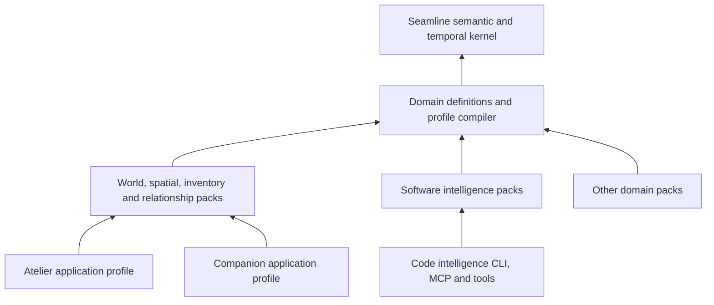

# Seamline: extensible semantic and temporal engine

Status: proposed expanded target, 2026-09-09. This specification extends the [shared-world design](design.md) and governs its general domain model. The [codebase intelligence requirements](codebase-intelligence.md) are an equally important consumer. This is a design deliverable; it does not describe capabilities already implemented in Seamline.

**Seamline should define, store, relate, evolve and explain domain information across contexts and time.** Fictional worlds, inventories and codebases use the same engine, with different domain definitions, authority policies and operations. Atelier and the companion bot are applications of that engine, not the owners of its ontology.

“All types of information” means extensible modeling without changing the engine for each new domain. It does not mean all domains fit one flat entity type, all facts are automatically discoverable, or an untyped payload has been semantically understood.

## 1. Architectural foundation

The engine has five foundational responsibilities:

1. **Definitions:** versioned types, properties, relationships, constraints, commands and views.
2. **Identity and context:** stable objects, scoped claims, instances, universes, worlds and branches.
3. **Time and change:** timelines, temporal assertions, observations, transactions and historical queries.
4. **Evidence and reasoning:** attribution, authority, uncertainty, derivation, completeness and explanations.
5. **Execution and access:** atomic changes, ingestion, bounded queries, projections and authorization.

Domain packs contribute vocabulary and deterministic domain behavior. Application packs contribute specialized workflows, presentation rules, defaults and content. The engine validates and executes registered behavior; clients cannot bypass it by maintaining independent canonical models.



Software does not need to inherit physical inventory or fictional-world rules. It uses general contexts, timelines, artifacts and relationships directly, then imports any other useful pack explicitly. Nor does every world require simulation: an inventory application can use authoritative transactions and observations alone.

## 2. Universes, worlds, branches and contexts

These terms must have distinct operational meanings.

| Concept | Definition | Example |
|---|---|---|
| Universe | Named coherence domain: available domain packs, rule-set versions, reference systems and shared definitions | A fictional continuity; a real-world enterprise model; a simulation ruleset |
| World | Identifiable state-bearing population within a universe, with its own instances and history | One shared companion town; one story setting instance; a digital twin of a warehouse |
| Branch | Alternative evolution from a pinned base revision | A story alternative; simulation experiment; proposed schema change |
| Context | Scope qualifying an assertion or interpretation; can compose dimensions without implying physical containment | Agent belief, deployment environment, jurisdiction, scenario assumptions, observation scope |
| Snapshot | Immutable selection of a branch revision and temporal coordinates | World state at story time 21:03 as known at revision 57 |
| Perspective | Viewpoint/access interpretation over a context | What a character knows; what an operator is allowed to see |

Universes do not automatically merge because their entities have the same names. A definition can be imported across universes at a pinned version; importing it does not import all its instances or transfer ownership. Within a branched world, the same instance ID can have different contextual state. When deliberately copying an instance into a different world, mint a new identity with an explicit `derivedFrom` relationship. A cross-world identity correspondence is a typed mapping with evidence, not unconditional equality.

Security tenancy is orthogonal. Universe/world membership grants no access by itself. One tenant can maintain several universes; a shared universe can contain restricted contexts if explicitly authorized. Private claims, filtered query results and omitted edges must not leak through explanations, counts or derived projections.

Worlds may contain or reference regions/subworlds for organization, but do not require a rigid universal nesting tree. Physical containment, organizational ownership and context membership are separate relationships. Cross-world interaction is explicit; there is no global “same person” merge based on appearance or a label.

Branch ancestry is a DAG with pinned merge bases. A merge compares contextual changes to that base and reports incompatible exclusive facts, schema versions and assumptions. Deleting or archiving a branch does not delete shared instance definitions or rewrite its already-retained artifacts. Retention policy handles inaccessible or expired history separately.

## 3. Timelines are first-class objects

One timestamp field is insufficient. Seamline must model these distinct temporal dimensions:

| Dimension | Answers | Required representation |
|---|---|---|
| Valid/domain time | When does this fact hold in the modeled domain? | Instant, interval, uncertain interval or explicit unknown on a named timeline |
| Recorded time/revision | When did Seamline receive or accept it? | Commit sequence and recorded timestamp |
| Causal order | What depended on what? | Event dependencies / happens-before partial order |
| Scenario branch | Under which alternate history is it true? | Branch and pinned ancestry |
| Presentation time | Where does a scene/take occur in an edit? | Track/placement, start, duration and timebase |
| Source revision | Which code tree, document or external state was observed? | Immutable source revision/snapshot identity |

A timeline definition declares its domain, units, origin/calendar when applicable, resolution, ordering and clock policy. It can represent wall-clock time, simulated time, relative story time, frames, samples, or logical event sequence. A Git commit graph supplies ancestry, not a trustworthy total timeline from author timestamps. Distributed observations may remain partially ordered.

Clock advancement is an accepted operation with a persisted cursor. Pauses, rate changes, discontinuities and time skips are explicit events. A character can experience ten minutes while a film edit shows two seconds. A flashback reorders presentation; it does not move the world clock backwards.

Use exact rational frame rates and integer ticks where needed; 30000/1001 is not the same timebase as 30. Time mappings are explicit, potentially piecewise and noninvertible. An edit may omit, repeat or slow a world interval. Conversions carry precision and rounding policy; missing mappings produce unknown comparisons rather than invented alignment.

Minimum temporal queries:

- What held at domain time T, as known at recorded revision R?
- What changed between two snapshots, and which events caused it?
- Which claims overlap, precede, contain or meet another interval?
- What differs between branches at a selected common base?
- Which take depicts this event, and where does it occur in each edit?
- Which build/source/deployment revision was running during this incident interval?
- Which conclusions became stale after a late observation or correction?

Late evidence appends a correction with its valid interval and attribution. It does not erase earlier observations. Conflicting accounts can coexist as claims; canonical adoption depends on context and authority. History reconstruction requires retained events/checkpoints and pinned reducer/profile versions. An unavailable old reducer or expired evidence must be reported honestly.

## 4. The extensible metamodel

The definition system itself is modeled and versioned in Seamline. It needs:

| Definition object | Specifies |
|---|---|
| `DomainPack` | Namespace, version, dependencies, compatibility and documentation |
| `ObjectType` | Identity strategy, properties, facets, lifecycle and supported operations |
| `ValueType` | Primitive/structured value semantics, units, validation and canonical serialization |
| `PropertyDefinition` | Value type, requiredness, multiplicity, nullability, defaults and temporal behavior |
| `RelationType` | Typed role signatures, direction, inverses, cardinality and contextual/temporal constraints |
| `FacetDefinition` | Reusable capability, e.g. locatable, ownable, versioned, executable or observable |
| `ConstraintDefinition` | Predicate, applicability, required evidence/coverage, severity and explanation |
| `CommandDefinition` | Input, authorization, preconditions, reducer, effects and invariants |
| `Query/ViewDefinition` | Inputs, output contract, temporal/context scope, bounded evaluation and completeness |
| `MappingDefinition` | Source schema mappings, identity correspondences, units and information-loss rules |
| `ProjectionDefinition` | Consumer detail requirements, dependency tracking and unresolved-field behavior |

Favor composition of facets over deep inheritance or one massive union. A garment can be an object instance with locatable, ownable, wearable and visually describable facets. A container image is an immutable artifact with executable and content-addressed facets. Both have identity and provenance, but only the garment has a worn-on-body relation.

A relation may have multiple participants. `Transfer` binds item, from, to and authorizing party; `Invocation` binds caller, callee and execution; `Observation` binds observer, subject, instrument and artifact. Represent these as typed occurrences with stable IDs. An edge shorthand may project the occurrence, but cannot discard its time, roles or evidence.

Property semantics must distinguish `unknown`, `notApplicable`, `redacted`, absent optional value, explicit null, known empty collection, and source-unavailable. A value can be precise, approximate, bounded, disputed or derived. Every aggregate and validator must specify how these states propagate.

### Information forms

The kernel supports validated typed values and references; domain packs supply semantics for:

- Text, localized labels, aliases, enumerations, booleans and identifiers.
- Exact integers/decimals/rationals, quantities, currencies and units.
- Records, ordered sequences, unordered sets, maps and discriminated unions.
- Timepoints, intervals, calendars, recurrence and causal dependencies.
- Geospatial positions, relative poses, geometry references and coordinate transforms.
- Documents, code spans, tabular datasets, measurements and time-series segments.
- Images, audio, video, tracks, embeddings and other external artifacts.
- Plans, requirements, policies, events, observations, hypotheses and derived claims.

Large binary arrays, media, source files and time-series payloads can remain in appropriate storage. Seamline owns their identity, typed metadata, hashes, bounds, lineage and query handles. A locator is not evidence of current availability; an embedding is a retrieval aid, not proof of semantic identity. Content hashes identify bytes, not necessarily domain instances or their rights.

Self-description does not allow arbitrary user-defined code to execute. Declarative definitions compile against a bounded supported vocabulary. New computational primitives require trusted engine extensions with a capability manifest. Unknown profile payloads can be transported opaquely but cannot receive a validated-semantic status.

## 5. Domain object definition example

Illustrative future DSL; no parser for this syntax is claimed to exist:

```yaml
pack: example.equipment
version: 1.0.0
requires:
  seamline.identity: 1
  seamline.spatial: 1
  seamline.inventory: 1
  seamline.visual: 1
types:
  Equipment:
    identity: persisted-instance
    facets: [locatable, ownable, lendable, maintainable]
    properties:
      label: {type: localized-text, required: true}
      serial: {type: string, required: false}
      condition: {type: enum, values: [working, damaged, retired], temporal: true}
      appearance: {type: ref, target: seamline.visual.AppearanceDefinition}
    constraints:
      - id: active-custody-exclusive
        rule: inventory.single-current-custodian
      - id: retirement-prevents-new-loan
        rule: inventory.disallow-loan-when
        parameters: {property: condition, equals: retired}
commands:
  lend:
    uses: seamline.inventory.lend
views:
  available-equipment:
    uses: seamline.inventory.available-to-borrow
```

The definition is intentionally domain-specific while reusing placement, lending and availability semantics. Atelier adds an appearance binding and a shot; the bot adds conversational names and salience. A workshop application adds maintenance tasks. None implements another custody store.

The compiler must resolve every referenced pack and primitive against these declared dependencies. Omitted dependencies are errors, not implicit imports. Defaults are also explicit: a default condition can be an initialization rule, but an unknown imported condition must not silently become “working.”

## 6. Fungible and non-fungible information and items

Fungibility describes interchangeability **for a purpose under stated criteria**, not merely whether an object has an ID. It is not inherently a blockchain concept.

| Model | Meaning | Required behavior |
|---|---|---|
| Unique instance | Particular identifiable object | Serial identity, placement, custody, ownership, condition and individual history |
| Stock lot | Quantity interchangeable within criteria | Exact quantity/unit, lot properties, ownership/custody allocation and movements |
| Material/batch | Aggregate with composition and production lineage | Transformation inputs/outputs, waste/yield and measurement precision |
| Individuated unit | A formerly interchangeable unit given individual identity | Explicit extraction from a lot and origin link; decrement lot atomically |
| Digital artifact | Identifiable information content or rendition | Copies and derivations do not imply physical quantity conservation |
| Entitlement/capacity | Right to use a resource or bounded allocation | Separate entitlement holder, usage/reservation and expiry semantics |

Two sealed batteries may be interchangeable until one is installed or develops a fault. Two identical jackets can still be distinct instances. Medicine batches with different expiry dates need separate equivalence classes. Software copies share bytes but can have different deployment identities and access entitlements. A transferable game token, physical tool and API quota can all be modeled without assuming identical ownership or conservation rules.

Minimum inventory capabilities:

- Definitions, instances, lots, assemblies, containers and nested placement.
- Ownership, custody, possession, equipment, access and reservation as separate relations.
- Exact quantities, units, allocation, availability and conservation policies.
- Purchase/acquisition, gift, loan, return, transfer, split, merge, consume, produce and dispose operations.
- Lot-to-instance and instance-to-stock transitions with retained provenance and eligibility checks.
- Conditions, wear, repair, expiry, serial/batch identifiers and lifecycle states.
- Loss, uncertain location, conflicting observations and subsequent reconciliation.
- Reservations that reduce availability without changing ownership; concurrent allocation protection.
- Multi-owner shares or group ownership as explicit extensions, with defined totals and rights.
- Movement history and transformation lineage, including fungible transactions.

“Owned,” “on hand,” “available,” “equipped,” and “visible” are different queries. An object can be owned by A, carried by B, located in C, reserved for D and outside the current shot. The engine must represent that combination without duplicating the item.

## 7. Information detail and observation

Fidelity is not one scalar across every domain. Each projection states requirements along independent dimensions: semantic detail, geometric precision, temporal resolution, observational coverage, simulation resolution and presentation detail.

Every detail answers: what entity/property does this describe, in which context and interval, from which source, with what precision, and under what authority? “Red jacket” can be canonical appearance, lighting-distorted observation, requested rendering style or a character's belief. Their text may match; their semantics do not.

Promotion may request more source evidence, compute a derived view or propose invented detail within an authored universe. Only a permitted adoption operation creates accepted state. Demotion reduces simulation or display work without deleting identity/history. A remembered object does not disappear when it leaves a frame; an unobserved property stays unknown.

For code intelligence, this same mechanism distinguishes package-level understanding, symbol resolution, field lineage, path-sensitive data flow and runtime traces. A package summary cannot pretend to answer a field-level impact question. A dynamic trace proves an observed execution; it does not establish all possible behavior.

## 8. Cross-domain reasoning

The engine supports typed traversal, temporal joins, bounded aggregation, invariant evaluation, source reconciliation and traceable derivation. Explicitly separate:

- Accepted state and observations.
- Normative requirements and descriptive reality.
- Planned, simulated and actual events.
- Declared relationships and inferred correspondences.
- Identity equality, conceptual similarity and derivation.
- Absence established by complete coverage and absence from a partial view.

A requirement can state intended behavior without proving implementation. A fictional universe can authorize impossible physics without contradicting another universe. Production and staging can legitimately run different versions. Rules compare claims only when their scopes, modality and temporal coordinates make them comparable.

Reasoners declare the domains and completeness they need, supported inference patterns and resource limits. Findings include premises, mappings, rejected alternatives when relevant, authority and residual unknowns. Conflicting evidence remains inspectable. Do not advertise general logical completeness, perfect causal inference or universal automatic understanding.

## 9. Definition evolution and operation

Domain packs are immutable by version. Breaking changes include identity rules, units, temporal interpretation, stronger required fields, changed cardinality and changed meaning under the same name. A migration maps old records and reports information loss; defaults do not silently backfill unknown facts as observations.

Validate profile composition before applying it to a world or code project. Store active profile versions in snapshots and receipts. Derived outputs record compiler/reasoner versions and dependency manifests. Incremental invalidation follows changed inputs without rewriting historical artifacts. Replay is deterministic relative to recorded inputs and pinned versions, not relative to the current wall clock.

Storage must support both rebuildable projections from external authoritative sources and engine-owned transactional domains. In the former, source systems remain authoritative for their artifacts; in the latter, Seamline's accepted ledger is authoritative. Neither mode permits an application cache to become a hidden second writer.

Performance is bounded and measurable: indexed current-state queries, incremental ingestion, checkpointed history, retained-event policies, query budgets and pagination. One graph object per video pixel or every timeseries sample is not required. Typed external datasets retain fine detail while the graph exposes useful entities, events and bounds.

## 10. Acceptance examples

The target is demonstrated when the engine can support all of these through domain definitions and shared primitives:

1. Two universes reuse a jacket definition but keep independent instances and ownership.
2. Two branches of one world evolve the same item differently without state leakage.
3. A late correction changes today's reconstruction of yesterday while preserving yesterday's recorded view.
4. One stock lot becomes serialized units; concurrent reservation cannot allocate the same last unit twice.
5. A bot changes custody and Atelier renders the exact resulting snapshot, then places the take on two different edit timelines.
6. A code commit produces an artifact deployed to a runtime instance; an incident resolves to the observed artifact revision, not current `main`.
7. A custom equipment domain adds maintenance and borrowing rules without kernel changes or another inventory implementation.
8. A derived answer reports unavailable evidence rather than silently inventing a fact or declaring a requirement satisfied.

The comprehensive software capabilities are specified separately in [codebase-intelligence.md](codebase-intelligence.md). The [implementation design](design.md) remains the starting engine migration and two-application integration slice; the breadth defined here is the architectural target, not an assertion that every domain ships in the first release.
